# Дипломная работа по профессии «Системный администратор»

**Студент:** Страхов Игорь

---

## Содержание

* [Задача](#задача)
* [Схема инфраструктуры](#схема-инфраструктуры)
* [Состав репозитория](#состав-репозитория)
* [Развёртывание](#развёртывание)
* [Сайт](#сайт)
* [Мониторинг](#мониторинг)
* [Логи](#логи)
* [Сеть](#сеть)
* [Резервное копирование](#резервное-копирование)
* [Решения и компромиссы](#решения-и-компромиссы)
* [Если что-то пошло не так](#если-что-то-пошло-не-так)

---

## Задача

Разработать отказоустойчивую инфраструктуру для сайта с мониторингом, сбором логов и резервным копированием. Инфраструктура размещается в Yandex Cloud, разворачивается Terraform и настраивается Ansible. Задание: [sys-diplom, вариант с Zabbix](https://github.com/netology-code/sys-diplom/blob/diplom-zabbix/README.md).

Токен облака в репозиторий не попадает: Terraform берёт его из переменной окружения `YC_TOKEN` (или ключ сервисного аккаунта из файла вне репозитория), пароли сервисов Ansible генерирует сам и складывает в `ansible/credentials/`, который тоже в `.gitignore`.

---

## Схема инфраструктуры

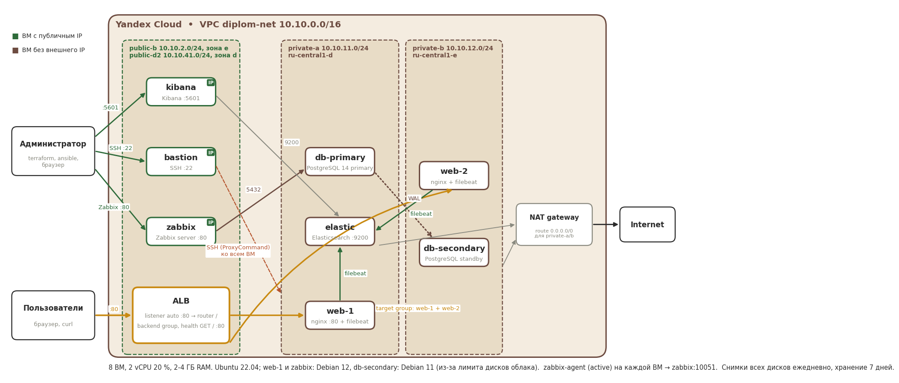

| ВМ | Зона | Подсеть | Внешний IP | ОС | Диск | Что делает |
|---|---|---|---|---|---|---|
| bastion | ru-central1-e | public-b | да | Ubuntu 22.04 | 8 ГБ SSD | вход по SSH |
| zabbix | ru-central1-d | public-d2 | да | Debian 12 | 5 ГБ HDD | Zabbix server 7.0 LTS и веб-интерфейс (порт 80) |
| web-1 | ru-central1-d | private-a | нет | Debian 12 | 5 ГБ HDD | nginx, filebeat, zabbix-agent |
| web-2 | ru-central1-e | private-b | нет | Ubuntu 22.04 | 8 ГБ HDD | nginx, filebeat, zabbix-agent |
| db-primary | ru-central1-d | private-a | нет | Ubuntu 22.04 | 8 ГБ SSD | PostgreSQL 14, основной сервер БД Zabbix |
| db-secondary | ru-central1-e | private-b | нет | Debian 11 | 4 ГБ HDD | PostgreSQL 14, реплика (hot standby) |
| elastic | ru-central1-d | private-a | нет | Ubuntu 22.04 | 8 ГБ HDD | Elasticsearch 8 |
| kibana | ru-central1-e | public-b | да | Ubuntu 22.04 | 8 ГБ HDD | Kibana 8 |

У всех ВМ 2 vCPU 20 %, 2 ГБ RAM (у elastic и kibana 4 ГБ), платформа standard-v3.

**Почему разные ОС и маленькие диски.** В каталоге заказчика Yandex Cloud действует лимит на суммарный размер дисков в зоне: 20 ГБ HDD и около 10 ГБ SSD на зону. Образ Ubuntu 22.04 занимает минимум 8 ГБ, и по такому лимиту в одной зоне помещается только три ВМ, то есть шесть на две зоны (зоны a, b, c и k в этом каталоге недоступны для создания ВМ). Чтобы получить все восемь ВМ из задания, часть ВМ сделана на образах Debian с меньшим минимальным диском:

* `zabbix` и `web-1`: Debian 12 (минимум 5 ГБ), Zabbix 7.0 для него есть в официальном репозитории;
* `db-secondary`: Debian 11 (минимум 3 ГБ, диск 4 ГБ). Zabbix 7.0 для Debian 11 уже не выпускается, но PostgreSQL 14 ставится из архива PGDG, версия совпадает с основным сервером, и этого достаточно для реплики. Репозитории Debian 11 переведены на `archive.debian.org`.

Роли Ansible работают на обоих семействах (условия по `ansible_distribution`). Если квота дисков будет больше, в `terraform/vms.tf` достаточно убрать поле `image` и поставить диск 8 ГБ.

Образы ВМ: Ubuntu 22.04 и Debian 11/12 (см. таблицу), платформа Intel Ice Lake (standard-v3), прерываемые. Имя ВМ совпадает с hostname, поэтому у каждой есть FQDN вида `web-1.ru-central1.internal`. В инвентаре Ansible внутренние хосты указаны только по FQDN.

---

## Состав репозитория

```
terraform/
  versions.tf            провайдеры yandex и local
  variables.tf           переменные (облако, каталог, зоны, SSH-ключ, preemptible)
  network.tf             VPC, 4 подсети, NAT-шлюз, таблица маршрутов
  security.tf            security groups
  vms.tf                 8 ВМ (одним ресурсом через for_each)
  alb.tf                 target group, backend group, HTTP router, ALB
  snapshots.tf           ежедневные снимки всех дисков, хранение 7 дней
  outputs.tf             адреса и генерация ansible/inventory/hosts.ini
  templates/             cloud-init и шаблон инвентаря
ansible/
  site.yml               весь стенд одной командой
  group_vars/all/        общие переменные (версии, адреса, пароли через lookup)
  roles/                 common, postgresql, zabbix_server, zabbix_agent,
                         zabbix_config, nginx, elasticsearch, kibana, filebeat
img/                     схема и скриншоты
```

---

## Развёртывание

### Что нужно на рабочей машине

* Terraform 1.5+ (из России удобнее скачать с зеркала `https://hashicorp-releases.yandexcloud.net/terraform/`)
* Ansible 2.15+ и `ssh`
* `yc` CLI, авторизованный в облаке
* SSH-ключ `~/.ssh/id_ed25519` (другой путь задаётся переменной `ssh_public_key_path`)

Если реестр Terraform недоступен, провайдеры ставятся с зеркала Яндекса. Файл `~/.terraformrc`:

```hcl
provider_installation {
  network_mirror {
    url     = "https://terraform-mirror.yandexcloud.net/"
    include = ["registry.terraform.io/*/*"]
  }
  direct {
    exclude = ["registry.terraform.io/*/*"]
  }
}
```

### Terraform

```bash
cd terraform
cp terraform.tfvars.example terraform.tfvars   # вписать cloud_id и folder_id
export YC_TOKEN=$(yc iam create-token)
terraform init
terraform apply
```

Вместо `YC_TOKEN` можно использовать ключ сервисного аккаунта с ролью `editor` на каталог: `export YC_SERVICE_ACCOUNT_KEY_FILE=~/.yc/sa-key.json` (одновременно с `YC_TOKEN` не задавать).

Создание занимает 5-10 минут, дольше всего поднимается балансировщик. В конце Terraform выводит адреса и сам пишет инвентарь `ansible/inventory/hosts.ini`:

```
bastion_ip  = "x.x.x.x"
site_url    = "http://x.x.x.x/"
zabbix_url  = "http://x.x.x.x/"
kibana_url  = "http://x.x.x.x:5601/"
```

> **Скриншот:** окончание `terraform apply` с блоком Outputs.

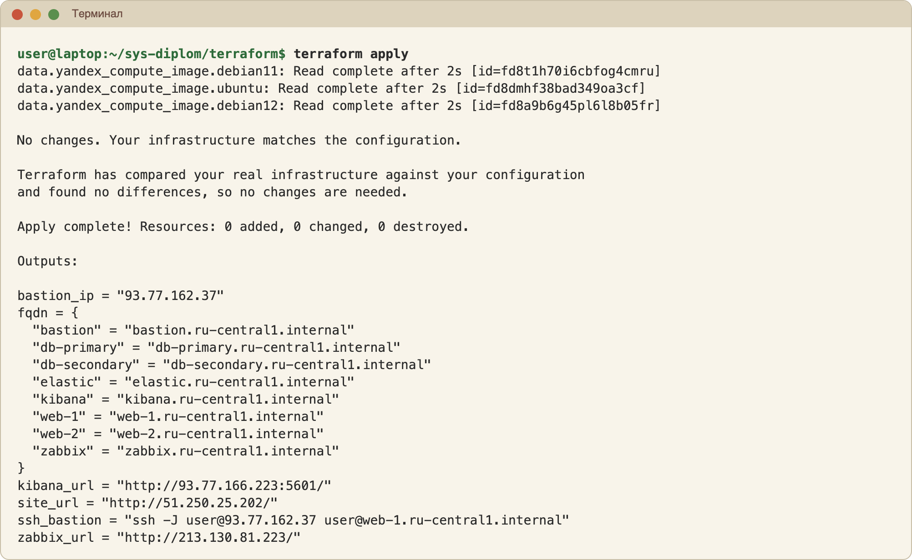

### Ansible

```bash
cd ../ansible
ansible-galaxy collection install -r requirements.yml
ansible all -m ping
ansible-playbook site.yml
```

Ansible подключается ко всем ВМ, кроме самого бастиона, через `ProxyCommand="ssh -W %h:%p user@<bastion_ip>"` (переменная `ansible_ssh_common_args` в инвентаре). Имена `*.ru-central1.internal` резолвятся на стороне бастиона внутренним DNS облака. Плейбук идемпотентный, полный прогон занимает 15-25 минут.

> **Скриншот:** вывод `ansible all -m ping` (все 8 хостов SUCCESS) и PLAY RECAP после `ansible-playbook site.yml` без failed.

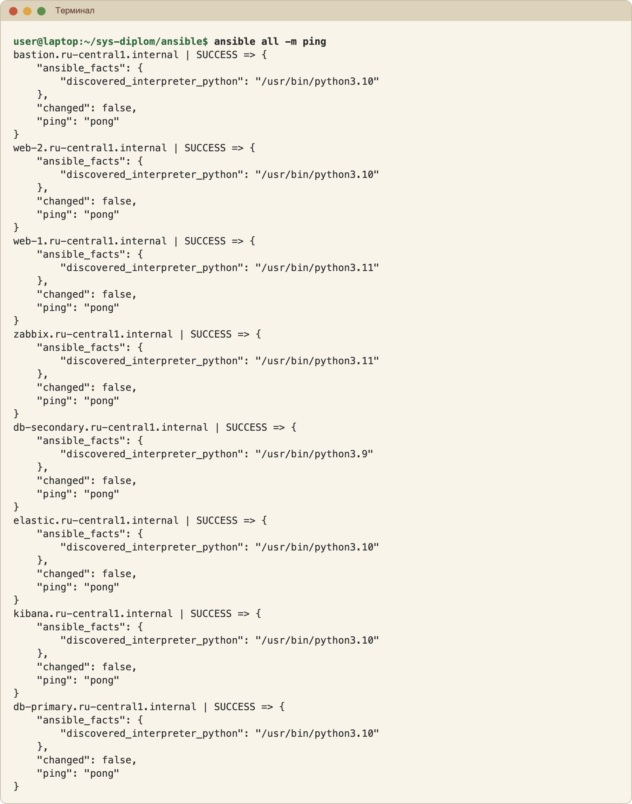
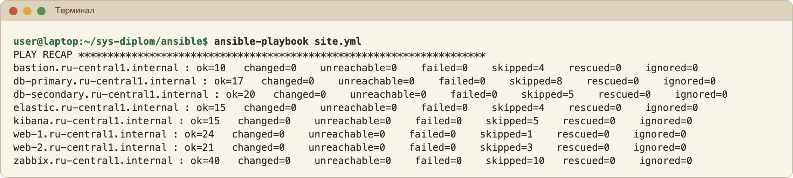

Пароль пользователя Admin в Zabbix: `cat ansible/credentials/zabbix_admin`.

Перед сдачей ВМ переводятся в постоянный режим (прерываемая ВМ живёт не больше 24 часов):

```bash
terraform apply -var preemptible=false
```

ВМ при этом перезапускаются, внешние IP могут смениться. Terraform сразу обновит outputs и инвентарь.

---

## Сайт

Две одинаковые ВМ `web-1` (зона d) и `web-2` (зона e) без внешних адресов. Роль `nginx` ставит nginx и выкладывает один и тот же статический сайт в `/var/www/diplom`. Чтобы было видно, какой сервер ответил, nginx добавляет заголовок `X-Served-By: <hostname>`. Страница `/basic_status` (stub_status) открыта только для localhost, её читает агент Zabbix.

Балансировщик (`terraform/alb.tf`):

1. **Target group** `web-tg`: web-1 и web-2 по внутренним адресам.
2. **Backend group** `web-bg`: backend на target group, порт 80, healthcheck HTTP `GET /` на порт 80.
3. **HTTP router** `web-router`: виртуальный хост с маршрутом по префиксу `/` в backend group.
4. **Application Load Balancer** `web-alb`: размещён в public-d2 (зона d) и public-b (зона e), listener `http` с автоматическим внешним IPv4, порт 80, обработчик указывает на HTTP router.

Проверка:

```bash
curl -v http://<ALB_IP>:80
for i in 1 2 3 4; do curl -sI http://<ALB_IP>/ | grep X-Served-By; done
```

> **Скриншот:** вывод `yc alb target-group get`, `yc alb backend-group get` (вместе с `yc alb load-balancer target-states`: обе цели HEALTHY в зонах d и e), `yc alb http-router get` и `yc alb load-balancer get` (listener на 80 порту).

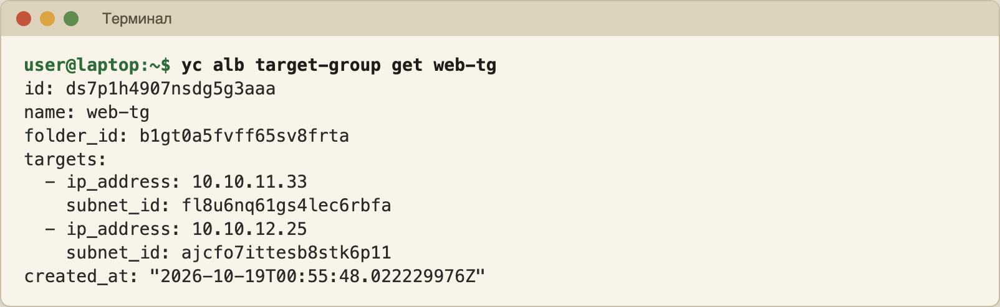
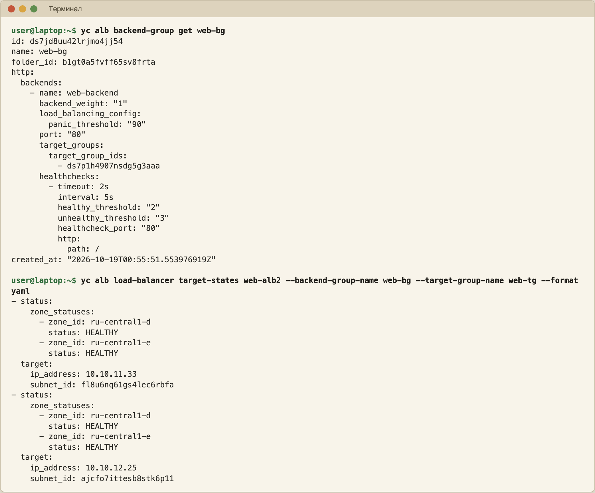
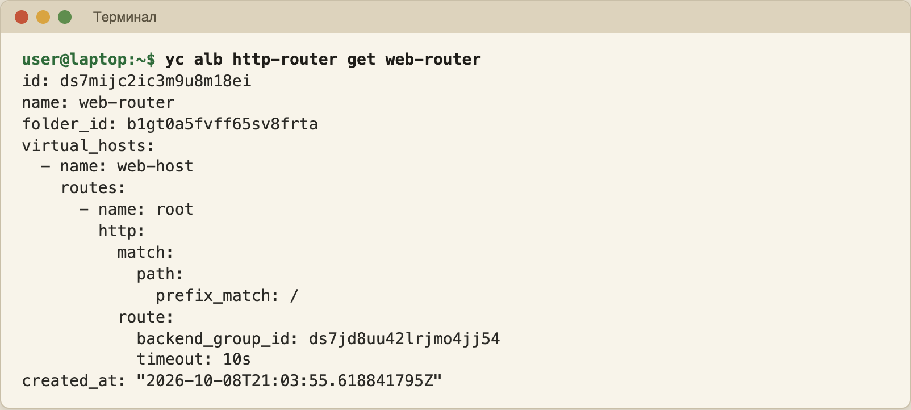
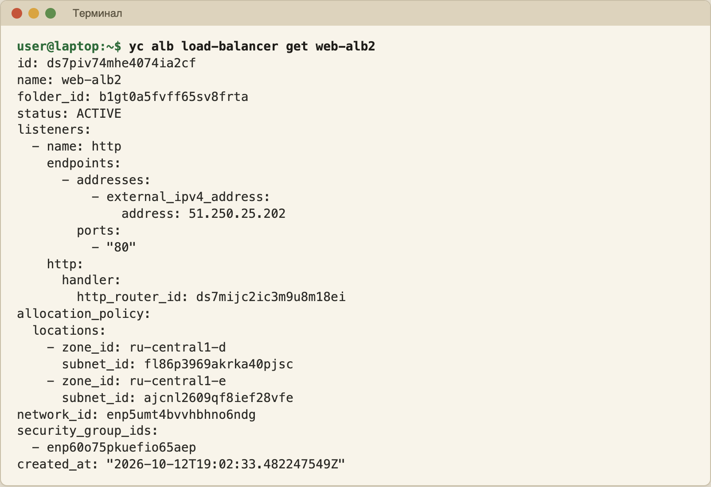

> **Скриншот:** вывод `curl -v http://<ALB_IP>:80` (ответ 200 и HTML страницы) и цикл с заголовком `X-Served-By`, где чередуются web-1 и web-2.

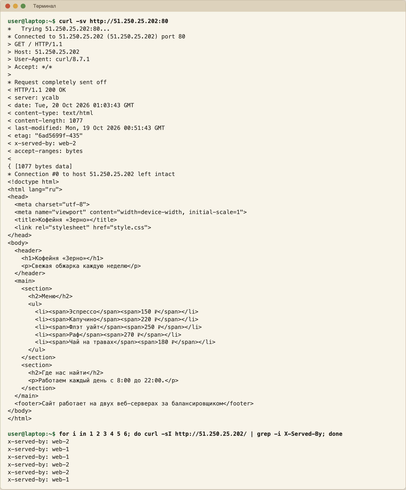

> **Скриншот:** сайт в браузере по адресу балансировщика.

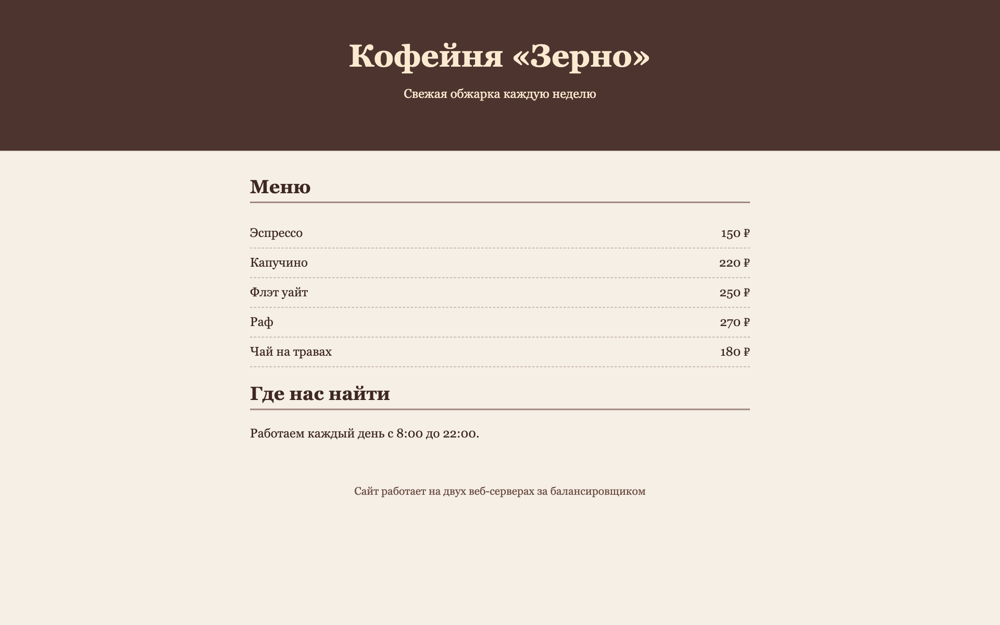

---

## Мониторинг

### Кластер БД

По заданию Zabbix хранит данные в отказоустойчивом кластере PostgreSQL из двух серверов в разных зонах (роль `postgresql`):

* `db-primary` (зона d): основной сервер, `wal_level=replica`, физический слот репликации `standby_slot`;
* реплика на `db-secondary` (зона e, группа `db_secondary`): сервер создаётся `pg_basebackup -R -S standby_slot`, работает в режиме hot standby и получает WAL потоковой репликацией;
* для Zabbix заведена отдельная роль `zabbix` с ограниченными правами: `NOSUPERUSER NOCREATEDB NOCREATEROLE`, она владеет только базой `zabbix`, у `PUBLIC` право `CONNECT` на эту базу отозвано;
* для репликации отдельная роль `replicator` с атрибутом `REPLICATION`;
* в `pg_hba.conf` доступ только из сети VPC по `scram-sha-256`, в security group порт 5432 открыт только для Zabbix-сервера (sg-zabbix) и между серверами БД (sg-db назначена db-primary и db-secondary).

Если основной сервер вышел из строя, реплика повышается до основного, а Zabbix переключается на неё:

```bash
# на db-secondary
sudo -u postgres psql -c "select pg_promote();"
# с машины администратора
ansible-playbook site.yml --limit zabbix -e zabbix_db_host=db-secondary.ru-central1.internal
```

Проверка репликации:

```bash
ssh -J user@<bastion_ip> user@db-primary.ru-central1.internal \
  "sudo -u postgres psql -c 'select client_addr, state, sync_state from pg_stat_replication;'"
ssh -J user@<bastion_ip> user@db-secondary.ru-central1.internal \
  "sudo -u postgres psql -c 'select pg_is_in_recovery();'"
```

> **Скриншот:** вывод двух команд выше: на primary строка с адресом реплики в состоянии `streaming`, на secondary `pg_is_in_recovery = t`. Плюс `\du` на primary, где видно, что у роли zabbix нет прав суперпользователя.

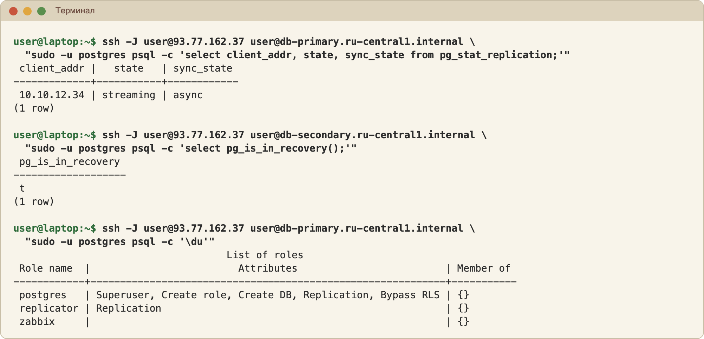

### Zabbix

* `zabbix` (зона d, внешний IP, Debian 12): Zabbix server 7.0 LTS, веб-интерфейс на nginx + php-fpm, порт 80. База на `db-primary`. Схема импортируется плейбуком, мастер установки не нужен: `zabbix.conf.php` кладётся шаблоном.
* На **всех** ВМ стоит `zabbix-agent` в активном режиме: агент сам подключается к серверу на порт 10051. Поэтому на ВМ не нужно открывать входящий 10050, а у бастиона наружу открыт только 22 (SSH), у Zabbix-сервера только 80.
* Роль `zabbix_config` через API Zabbix: меняет пароль Admin, импортирует шаблон и хосты (`configuration.import`, повторный запуск ничего не дублирует), удаляет стандартный хост «Zabbix server» и создаёт дашборд.

Шаблоны на хостах:

| Хосты | Шаблоны |
|---|---|
| все ВМ | Linux by Zabbix agent active |
| web-1, web-2 | + Diplom nginx |
| zabbix | + Zabbix server health |

`Diplom nginx` (`ansible/roles/zabbix_config/files/template_nginx.yaml`) сделан на основе стандартного «Nginx by Zabbix agent active»: те же метрики stub_status (запросы в секунду, соединения, сброшенные соединения, доступность и время ответа), но без обнаружения процессов nginx, у которого элемент «CPU utilization» совпадал по имени с CPU всей ВМ и путал дашборд. Дополнительно по `access.log` считаются ответы 4xx и 5xx и все запросы в минуту (`log.count`), доля 5xx в процентах, есть триггеры на рост ошибок.

### Дашборд «Diplom USE»

Дашборд создаётся автоматически и построен по принципу USE (Utilization, Saturation, Errors). Описание лежит в `ansible/roles/zabbix_config/templates/dashboard.json.j2`.

Страница **USE: ВМ**:

| Ресурс | Utilization | Saturation | Errors |
|---|---|---|---|
| CPU | CPU utilization, % | Load average 1m | |
| RAM | Memory utilization, % | Available memory, % | |
| Диск | vda: Disk utilization, %; FS /: Space used, % | vda: Disk average queue size | r_await / w_await, мс |
| Сеть | eth0: Bits received / sent | | eth0: packets with errors, discarded |

Сверху таблица Top hosts по всем ВМ и соты CPU. Пороги (thresholds) в таблице и сотах: CPU и RAM жёлтый от 70 %, красный от 90 %; Load average 1,5 и 2 (у ВМ 2 vCPU); место на диске 80 и 90 %; загрузка диска 60 и 85 %; очередь диска 1 и 2; сетевые ошибки 1 и 10. На графиках включено отображение порогов триггеров (линия «> 90» и т. п.).

Страница **USE: HTTP** (только web-1 и web-2, группа Diplom/web):

* Utilization: запросы в секунду (stub_status) и в минуту (access.log);
* Saturation: активные и ожидающие соединения nginx, время ответа;
* Errors: ответы 4xx и 5xx в минуту, доля 5xx, сброшенные соединения.

Пороги: запросов в секунду 50 и 100, 5xx в минуту 1 и 10, доля 5xx 1 и 5 %, 4xx в минуту 30 и 60.

Чтобы на графиках HTTP были данные, можно дать нагрузку с ошибками 404:

```bash
for i in $(seq 1 300); do curl -s -o /dev/null http://<ALB_IP>/; curl -s -o /dev/null http://<ALB_IP>/nope; done
```

> **Скриншот:** Zabbix, Data collection → Hosts: 8 хостов, у всех зелёный значок ZBX (активный агент доступен).

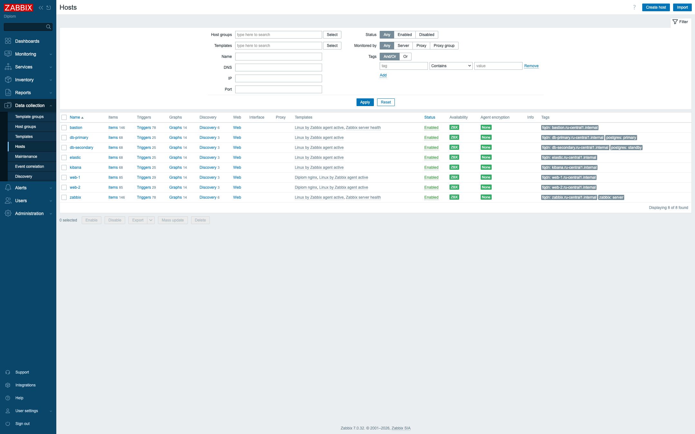

> **Скриншот:** дашборд «Diplom USE», страница «USE: ВМ» целиком (таблица с порогами, соты, графики CPU/RAM/диск/сеть).

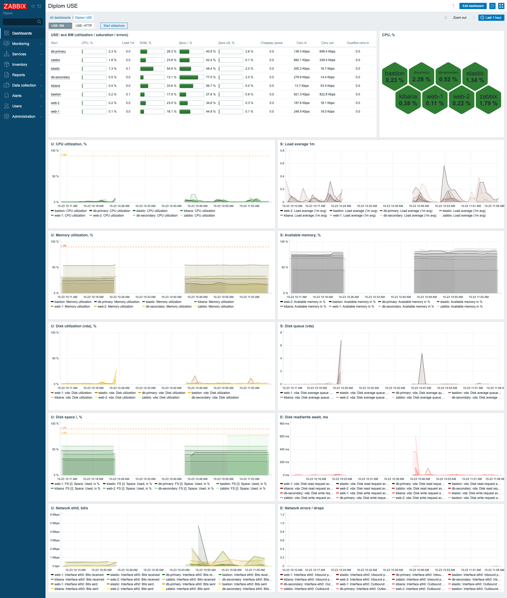

> **Скриншот:** страница «USE: HTTP» после нагрузки curl-ом (видны запросы и 4xx).

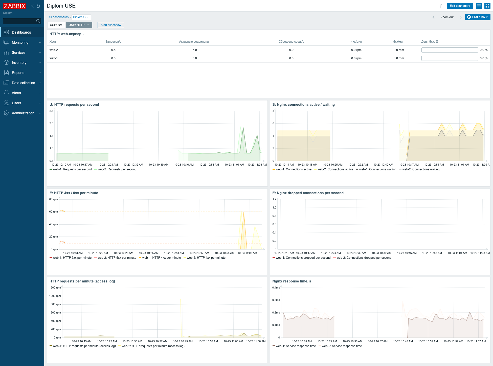

> **Скриншот:** Monitoring → Latest data по web-1, фильтр по тегу component: http.

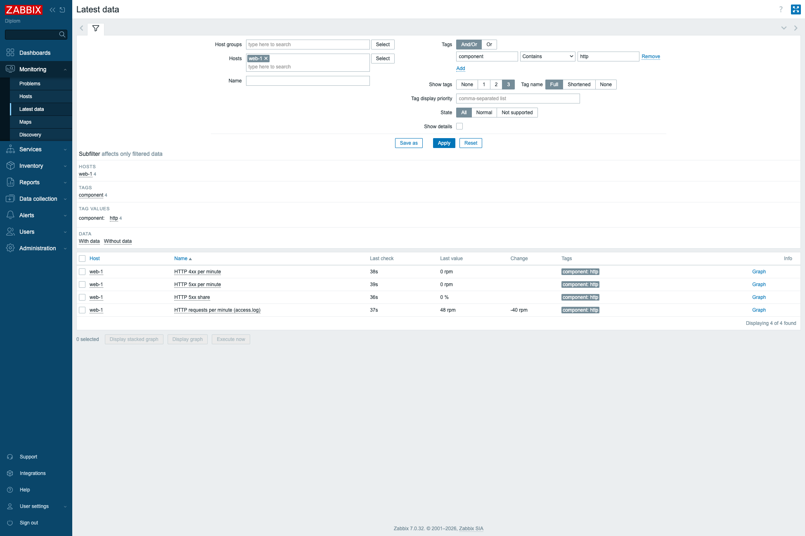

---

## Логи

* `elastic` (зона d, без внешнего IP): Elasticsearch 8, single-node, порт 9200 открыт security group только для web-серверов и kibana.
* `kibana` (зона e, внешний IP): Kibana 8 на порту 5601, подключена к `http://elastic.ru-central1.internal:9200`, интерфейс на русском.
* На web-1 и web-2 стоит Filebeat с модулем `nginx`: `access.log` и `error.log` уходят напрямую в Elasticsearch, разбор полей делает ingest pipeline модуля.
* Плейбук сам создаёт в Kibana представление данных `filebeat-*` и загружает готовые дашборды Filebeat для nginx.

Сайт Elastic из России отдаёт 403, поэтому пакеты ставятся из зеркала Яндекса `https://mirror.yandex.ru/mirrors/elastic/8/`, ключ подписи Elastic лежит в репозитории (`roles/elastic_repo/files/elastic.asc`). Версии всех трёх компонентов одинаковые и заданы в `group_vars/all/main.yml` (`elk_version`).

Проверка с web-1:

```bash
curl -s http://elastic.ru-central1.internal:9200/_cluster/health?pretty
curl -s 'http://elastic.ru-central1.internal:9200/_cat/indices/.ds-filebeat-*?v'
```

> **Скриншот:** вывод двух команд выше (status green или yellow, индекс filebeat с ненулевым docs.count).

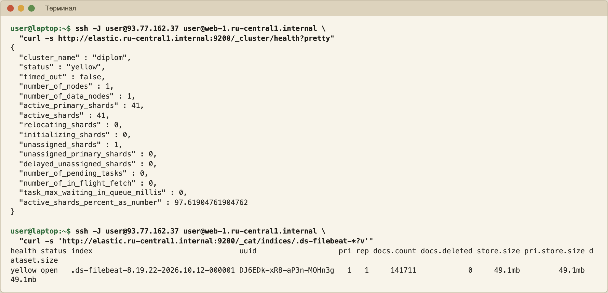

> **Скриншот:** Kibana, Discover, представление `filebeat-*`, фильтр `event.dataset : nginx.access`, видны запросы с обоих web-серверов (поле host.name).

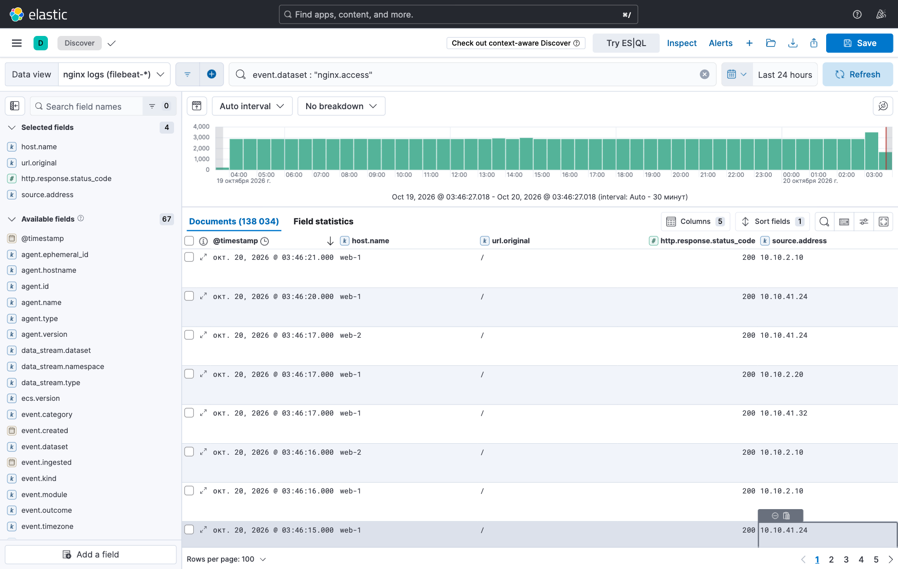

> **Скриншот:** то же с фильтром `event.dataset : nginx.error` (записи об открытии несуществующего файла после запросов на /nope).

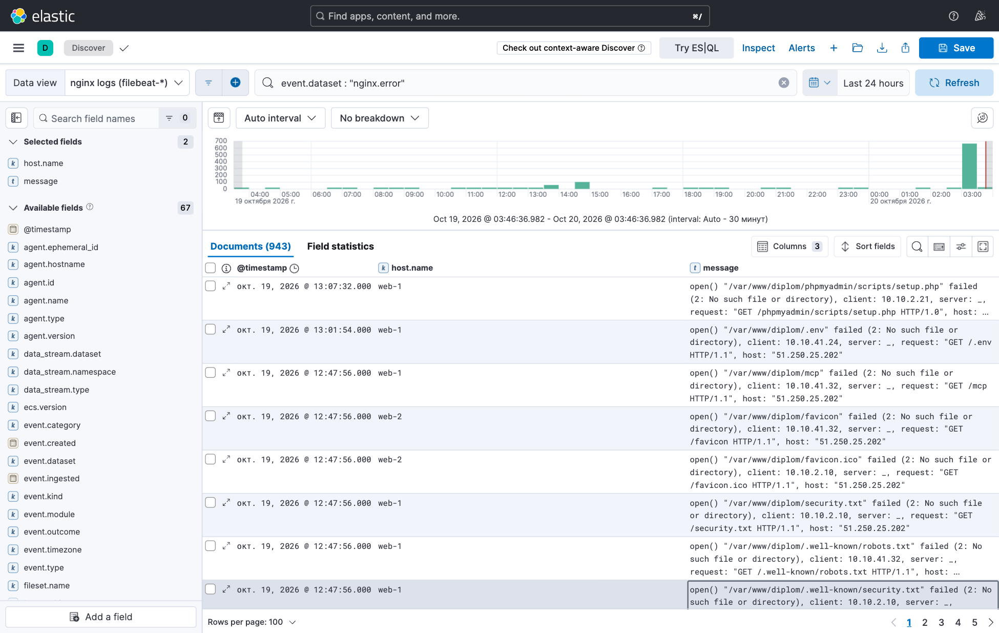

> **Скриншот:** дашборд «[Filebeat Nginx] Access and error logs ECS».

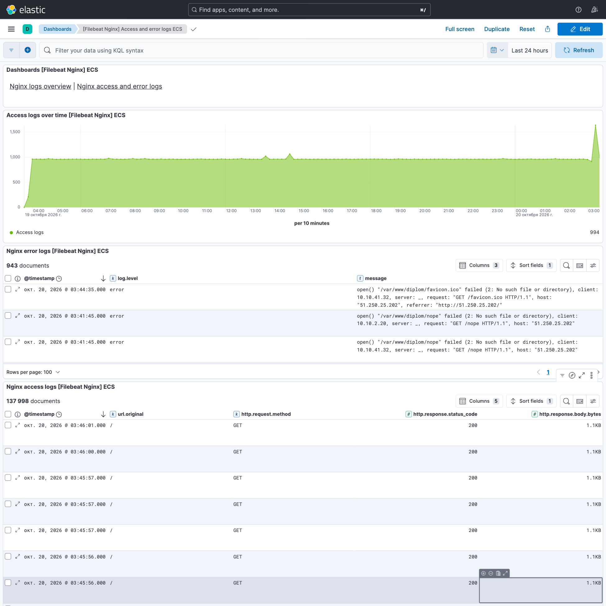

---

## Сеть

Одна сеть `diplom-net`, четыре рабочие подсети в зонах d и e:

| Подсеть | Зона | CIDR | Кто там |
|---|---|---|---|
| public-d2 | ru-central1-d | 10.10.41.0/24 | zabbix, узел ALB |
| public-b | ru-central1-e | 10.10.2.0/24 | bastion, kibana, узел ALB |
| private-a | ru-central1-d | 10.10.11.0/24 | web-1, db-primary, elastic |
| private-b | ru-central1-e | 10.10.12.0/24 | web-2, db-secondary |

Подсети `private-a3` и `public-a3` (зона a) остались от неудачных попыток создания ВМ в зоне a и не используются.

Внешние адреса только у bastion, zabbix и kibana. ВМ внутреннего контура выходят в интернет через NAT-шлюз: таблица маршрутов `diplom-private-rt` с маршрутом `0.0.0.0/0` на шлюз привязана к private-a и private-b.

Security groups (входящий трафик, исходящий разрешён везде):

| Группа | На каких ВМ | Входящие правила |
|---|---|---|
| sg-bastion | bastion | 22/tcp из интернета |
| sg-internal | все, кроме bastion | 22/tcp только из sg-bastion |
| sg-alb | балансировщик | 80/tcp из интернета, 30080/tcp от health checks |
| sg-web | web-1, web-2 | 80/tcp из sg-alb и от health checks |
| sg-zabbix | zabbix | 80/tcp из интернета, 10051/tcp из sg-internal и sg-bastion |
| sg-kibana | kibana | 5601/tcp из интернета |
| sg-elastic | elastic | 9200/tcp из sg-web и sg-kibana |
| sg-db | db-primary, db-secondary | 5432/tcp из sg-zabbix и внутри sg-db |

Всё, что явно не разрешено, запрещено. Зайти по SSH можно только через бастион:

```bash
ssh -J user@<bastion_ip> user@web-1.ru-central1.internal
```

> **Скриншот:** вывод `yc vpc subnet list`, `yc vpc gateway list` и `yc vpc route-table get`: подсети, NAT-шлюз и маршрут по умолчанию.

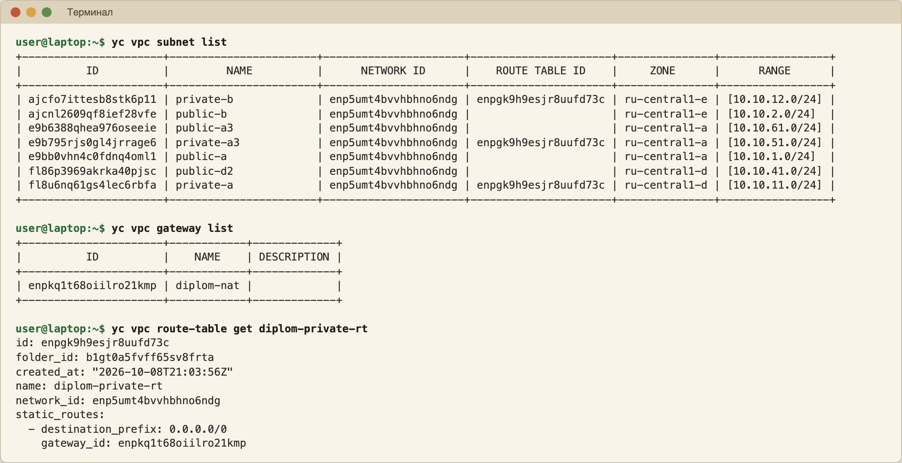

> **Скриншот:** вывод `yc vpc security-group list` и `yc vpc security-group get` для sg-bastion и sg-internal.

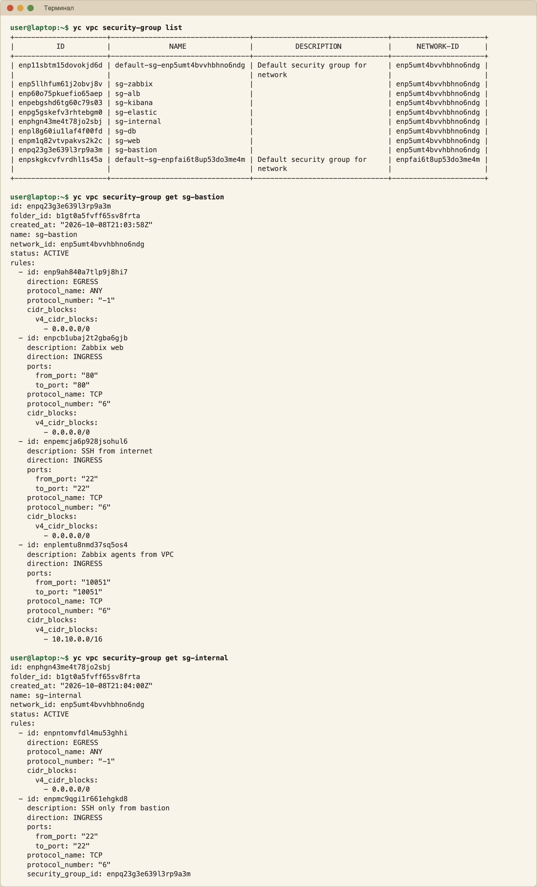

> **Скриншот:** вывод `yc compute instance list`: 8 ВМ, у web/elastic/db нет публичного адреса.

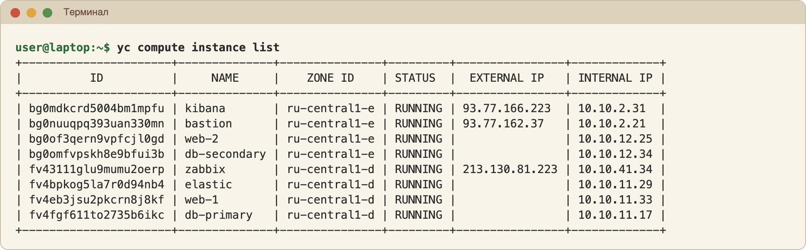

> **Скриншот:** вход на web-1 через бастион (`ssh -J ...`, затем `hostname -f` и `curl -sI https://ya.ru | head -1`, чтобы показать выход в интернет через NAT), и попытка зайти на web-1 напрямую по внутреннему адресу `ssh user@10.10.11.33`, которая не проходит.

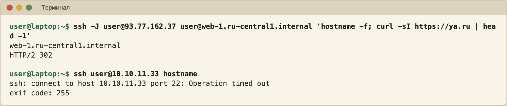

---

## Резервное копирование

`terraform/snapshots.tf`: расписание `daily-7d` создаётся Terraform, в него включены загрузочные диски всех 8 ВМ. Снимок делается каждый день в 01:00 UTC (`0 1 * * *`, переменная `snapshot_cron`), каждый снимок хранится 168 часов, то есть неделю.

> **Скриншот:** вывод `yc compute snapshot-schedule get daily-7d` и `list-disks`: cron, срок хранения 7 дней, 8 дисков.

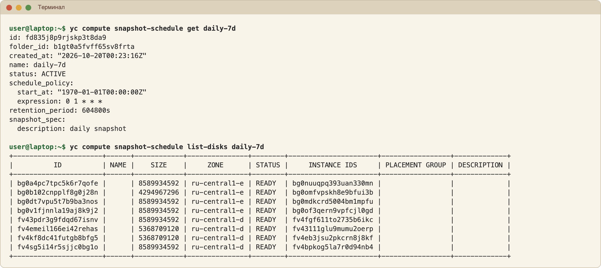

> **Скриншот:** вывод `yc compute snapshot list`: снимки дисков, созданные расписанием. Первые снимки пересозданных ВМ `zabbix`, `web-1` и `db-secondary` сделаны вручную (`yc compute snapshot create`), дальше их делает расписание.

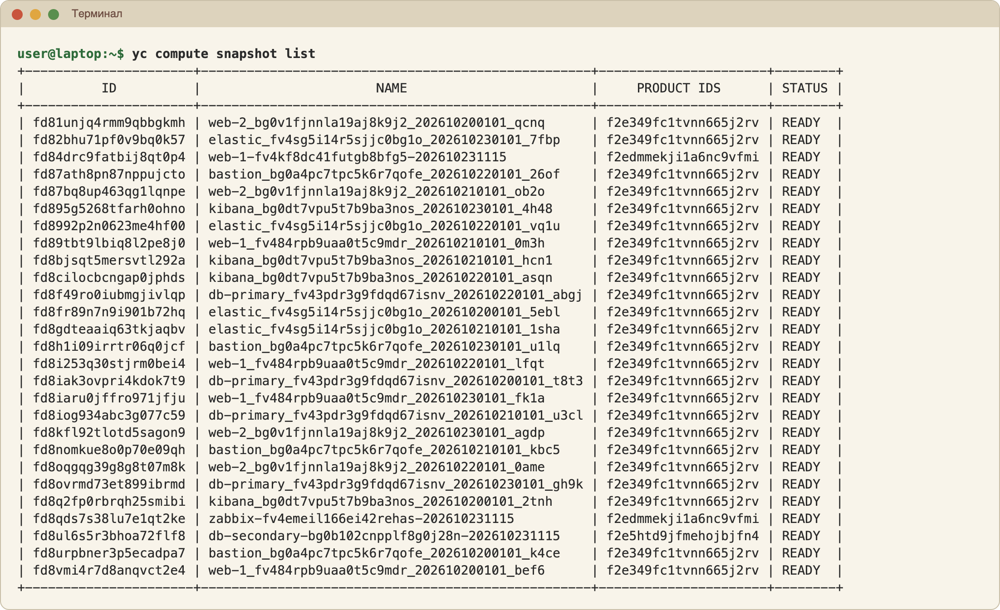

---

## Решения и компромиссы

Из-за лимита облака на объём дисков в зоне (см. раздел «Схема инфраструктуры») часть ВМ работает на Debian с небольшими дисками, но все восемь ВМ из задания существуют: Zabbix server на отдельной ВМ `zabbix`, реплика PostgreSQL на отдельной `db-secondary`.

* **Активные агенты Zabbix.** Агент сам подключается к серверу, поэтому входящий порт 10050 не открыт ни на одной ВМ, а на бастионе снаружи доступны только SSH и веб-интерфейс Zabbix.
* **Отдельная подсеть public-b.** ALB размещён в двух зонах, чтобы он пережил отказ одной зоны. Для этого нужна публичная подсеть в каждой из двух зон.
* **Кластер БД.** Потоковая репликация с ручным переключением (`pg_promote()`). Автоматический failover (Patroni и т. п.) не делал, чтобы не усложнять стенд, для диплома важна именно реплика в другой зоне.
* **Безопасность Elastic.** В Elasticsearch выключен xpack security: он доступен только из внутренней сети, а security group пускает на 9200 только web-серверы и Kibana. Kibana открыта наружу без пароля, чтобы проверяющий мог зайти; в реальной работе её надо закрыть паролем или VPN.
* **Пакеты вместо Docker.** Elastic ставится пакетами из зеркала Яндекса, без Docker на ВМ. Если зеркало недоступно, адрес меняется переменной `elastic_repo_url`.
* **Пароли.** Генерируются `lookup('password')` при первом запуске и хранятся в `ansible/credentials/` на машине администратора, в git их нет.
* **Прерываемые ВМ.** Для экономии `preemptible = true` по умолчанию, в этом стенде выставлено `false` (ВМ постоянные, как требует задание).

---

## Если что-то пошло не так

* **`terraform init` не может скачать провайдер.** Нужен `~/.terraformrc` с зеркалом Яндекса (см. выше).
* **`Error: ... quota`** в каталоге не хватает квоты на ВМ, диски или внешние адреса. Нужно 8 ВМ (суммарно около 50 ГБ дисков, при лимите 20 ГБ HDD и около 10 ГБ SSD на зону см. раздел «Схема инфраструктуры»), 3 публичных адреса и 1 балансировщик.
* **Ansible висит на подключении.** Проверить `ssh user@<bastion_ip>` и `ssh -J user@<bastion_ip> user@web-1.ru-central1.internal`. После `terraform apply` ВМ ещё 1-2 минуты выполняют cloud-init, плейбук ждёт его сам.
* **Ошибка apt "Could not get lock".** Это cloud-init обновляет пакеты на первом запуске, повторить плейбук через минуту.
* **Бэкенды ALB в статусе UNHEALTHY.** Сначала должен отработать плейбук (nginx), потом балансировщику нужно 10-20 секунд. Проверить `curl -I http://localhost/` на web-1.
* **Прерываемая ВМ остановилась.** Запустить её в консоли или `yc compute instance start <имя>`; внешний IP у прерываемых ВМ может смениться, тогда снова выполнить `terraform apply` (обновит инвентарь и outputs).
* **Нет данных в Kibana.** На web-1: `sudo filebeat test output` и `sudo journalctl -u filebeat -n 50`. Потом сделать пару запросов к сайту и обновить Discover за последние 15 минут.
* **В Zabbix хост серый.** На ВМ: `sudo tail /var/log/zabbix/zabbix_agentd.log`; в `/etc/zabbix/zabbix_agentd.conf` должно быть `ServerActive=zabbix.ru-central1.internal` и `Hostname`, совпадающее с именем хоста в Zabbix.

Удалить стенд:

```bash
cd terraform && terraform destroy
```
